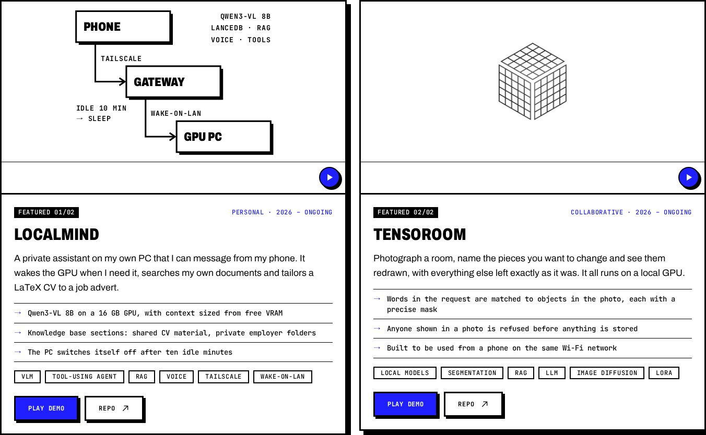
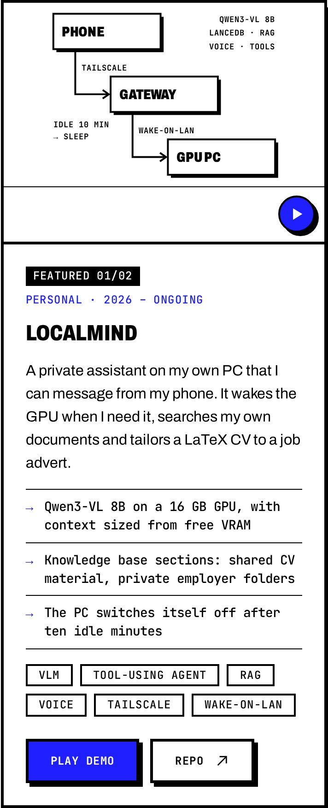
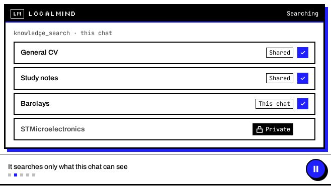
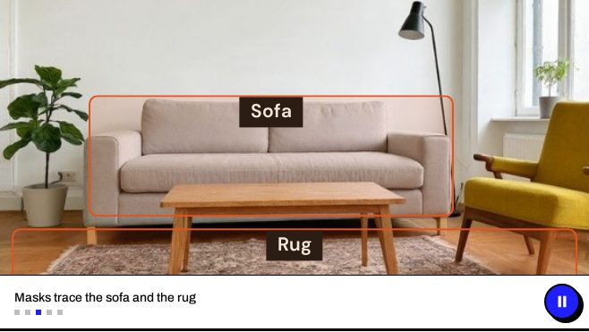
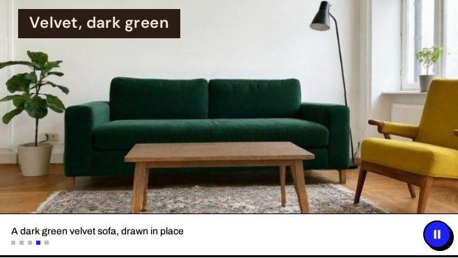

# hamishmarshalldawson.com

My portfolio site, live at [hamishmarshalldawson.com](https://hamishmarshalldawson.com). Built with React and framer-motion.

The Project vault has a **Featured builds** block: LocalMind and TensoRoom each get a card and a walkthrough that plays inside the page, so visitors can see the software without downloading or running it. Each demo is styled like its own app.

## Preview

Each Featured card has a round **Play** button on its picture. Pressing it plays a short demo inside that same picture box: a few scenes that animate themselves, each with a one-line caption and progress dots. The box never changes size, so nothing on the page moves. Pause holds the scene, and at the end the picture comes back with a replay button. With reduced motion or the site's FX switch off, scenes are shown without animation and the button steps through them.

| Desktop (1440px) | Phone (390px) |
|---|---|
|  |  |

### LocalMind

Five scenes, in the app's paper, ink and blue look: pasting a job advert, searching only what the chat can see, writing and compiling the CV, the answer streaming back with the PDF, and messaging the PC from a phone so it wakes.

| | |
|---|---|
|  |  |

### TensoRoom

Five scenes on the real room photos, in TensoRoom's own cream and rust look: the room, naming the pieces, the masks on the sofa and rug, the sofa redrawn in green velvet, and a before/after sweep.

| | |
|---|---|
|  |  |

## Where it lives

- `src/components/featured/`: the block (`FeaturedProjects.js`), the player that runs the scenes in the picture box (`DemoPlayer.js`) and one module per demo in `demos/`.
- `public/featured/tensoroom/`: the room photos the TensoRoom demo uses.
- To feature another project, add a `featured` entry to it in `src/components/projectdata.js` and register a demo module in `FeaturedProjects.js`. A demo exports its `scenes` (an id, a caption and a duration each) and a component that draws the current scene; it fills the box and freezes its animations when paused.
- `docs/preview/`: the screenshots above. They aren't part of the built site.
- `assets-src/`: full-size originals of the project images. The site uses the resized copies in `public/`.

## Running it

- `npm start`: dev server at http://localhost:3000
- `npm test`: Jest tests
- `npm run build`: production build in `build/`
- `npm run deploy`: builds and publishes `build/` to the `gh-pages` branch, which serves the live site
