# hamishmarshalldawson.com

My portfolio site, live at [hamishmarshalldawson.com](https://hamishmarshalldawson.com). Built with React and framer-motion.

The Project vault has a **Featured builds** block: LocalMind and TensoRoom each get a card and a walkthrough that plays inside the page, so visitors can see the software without downloading or running it. Each demo is styled like its own app.

## Preview

### The Featured block

| Desktop (1440px) | Phone (390px) |
|---|---|
| 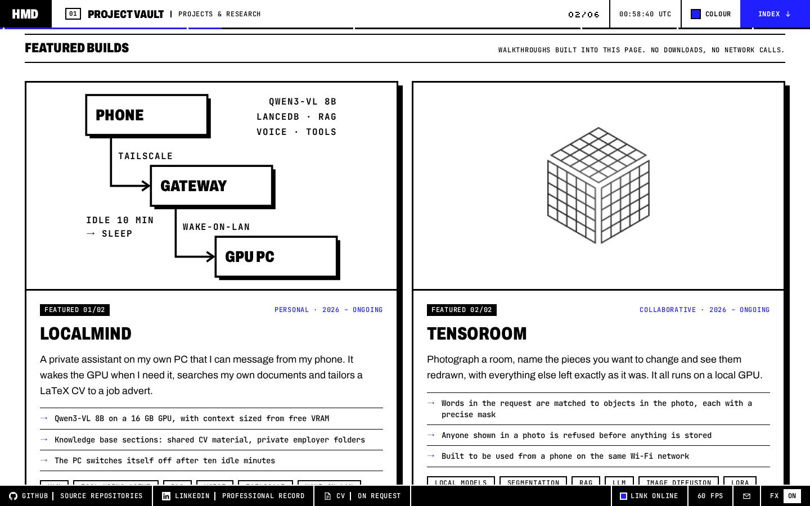 | 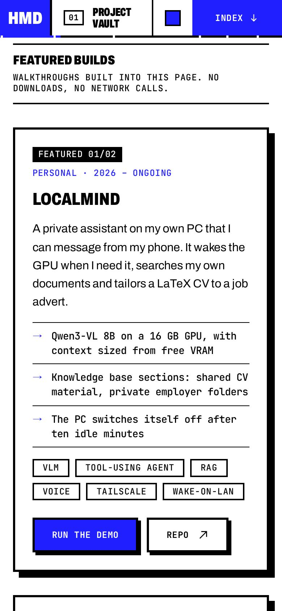 |

### Play tour

Press **Play tour** and a pointer walks through each step: it glides to each part of the screen, highlights it, labels it and presses it. Steps fade between each other, and a progress bar shows where the tour is. With reduced motion or the site's FX switch off, the tour is replaced by manual stepping.

| | |
|---|---|
| 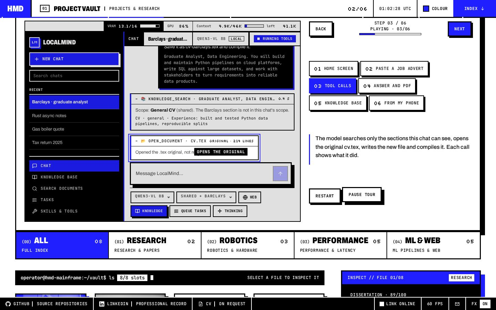 | 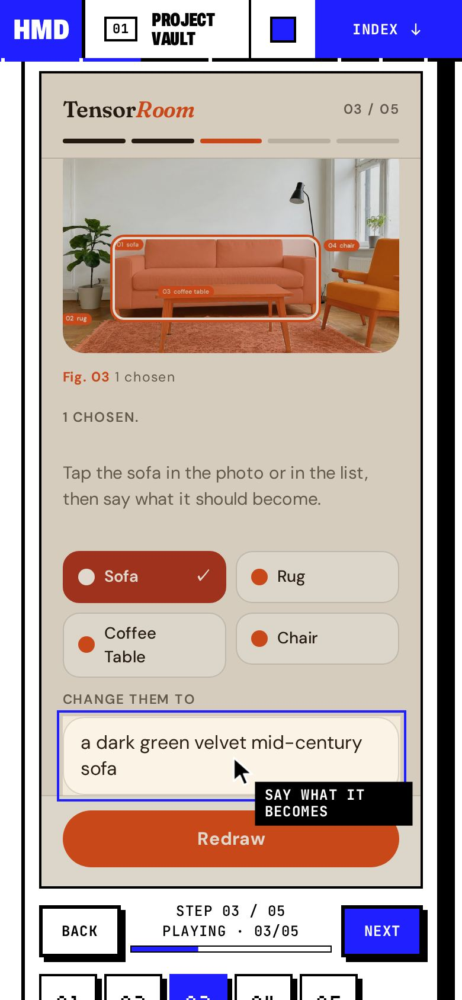 |
| LocalMind, step 03 mid-tour | TensoRoom on a phone, step 03 mid-tour |

### LocalMind demo

Styled like the current app, with paper, ink and a blue accent. Six steps: the chat home screen, pasting a job advert, the tool calls, the answer with a PDF, the knowledge base sections, and messaging the PC from a phone.

| | |
|---|---|
| 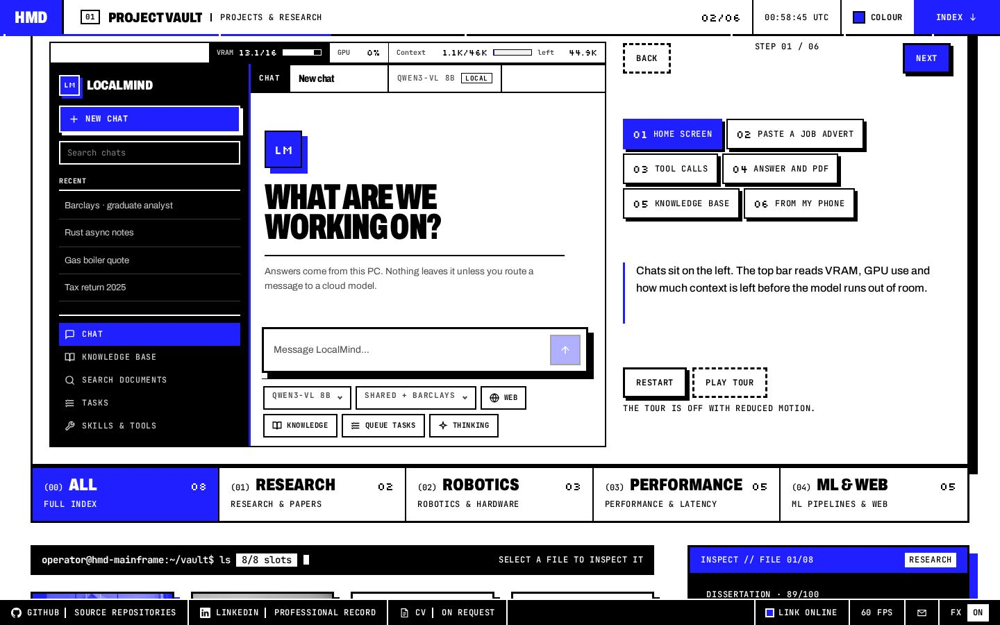 | 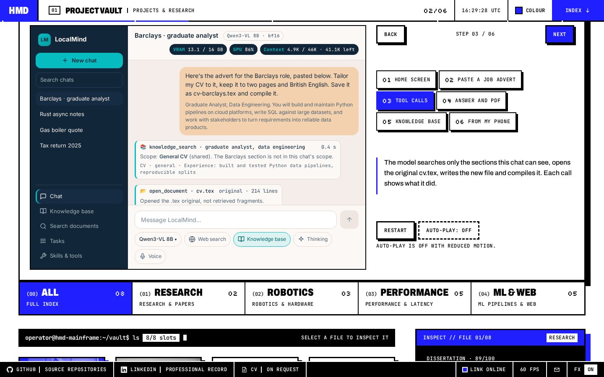 |
| 01 · Home screen | 03 · Tool calls |
| 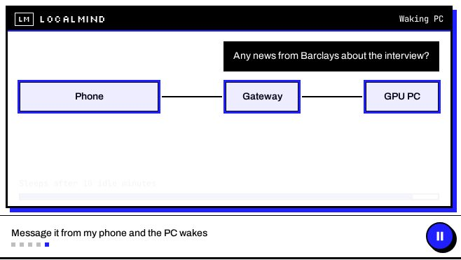 | 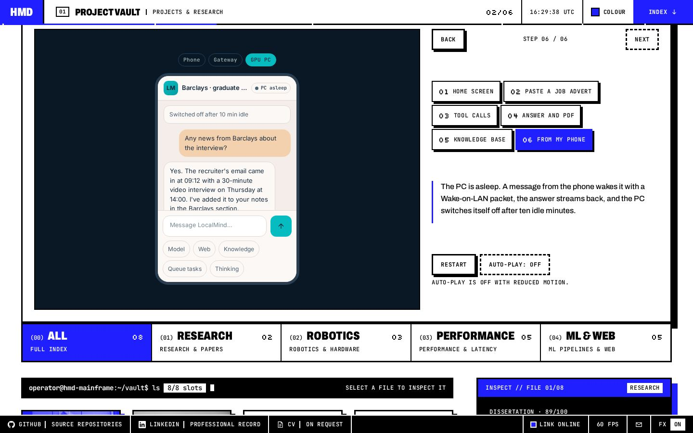 |
| 05 · Knowledge base | 06 · From my phone |

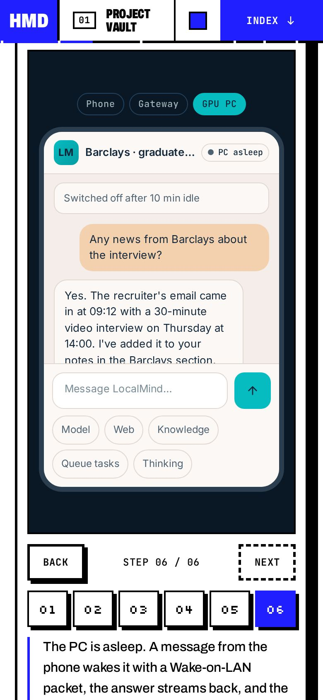
 Step 06 on a phone

### TensoRoom demo

Five steps, in the app's own phone layout, with the picture box in the same place on every step: your room, what to change, choose and describe, redraw, and a before/after comparison using real renders.

| | | | |
|---|---|---|---|
| 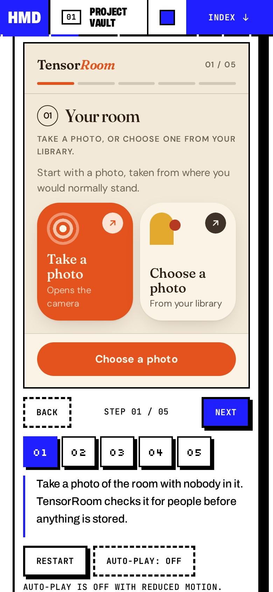 | 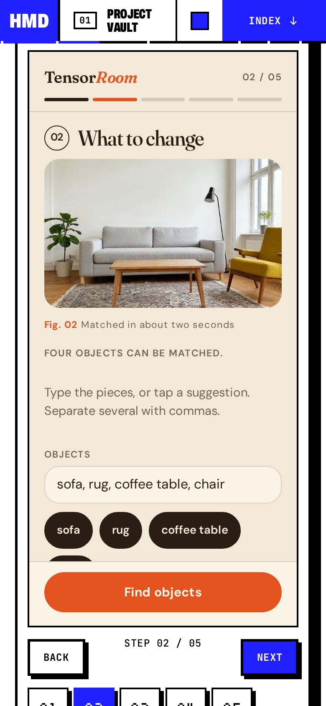 | 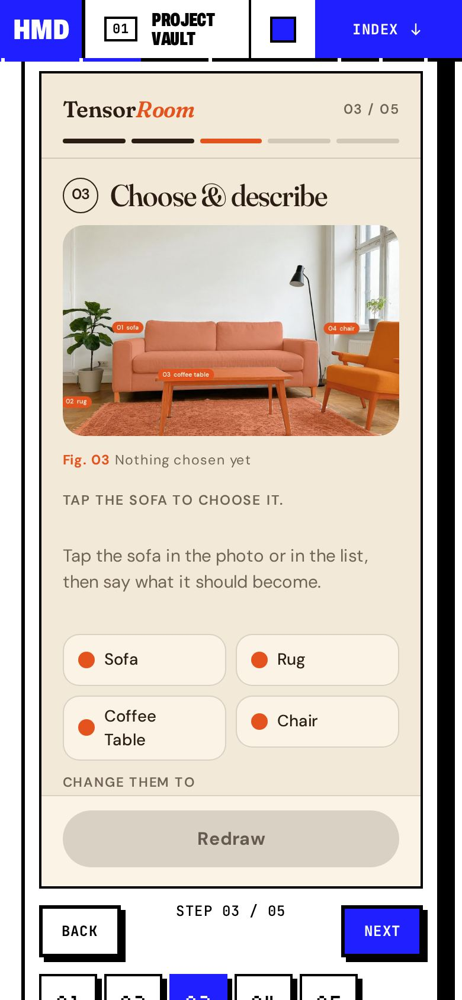 | 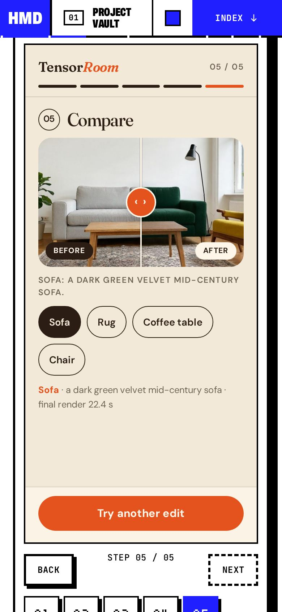 |
| 01 · Your room | 02 · What to change | 03 · Choose & describe | 05 · Compare |

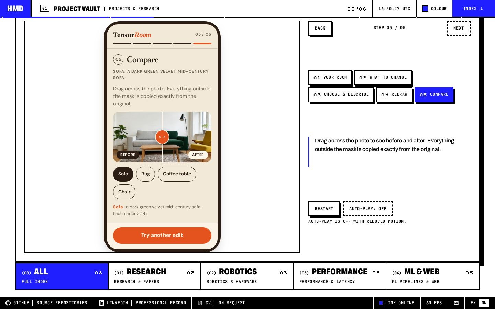
 Step 05 on desktop

## Where it lives

- `src/components/featured/`: the block (`FeaturedProjects.js`), the step and tour engine (`DemoStage.js`, `DemoCursor.js`) and one module per demo in `demos/`.
- `public/featured/tensoroom/`: the room photos the TensoRoom demo uses.
- To feature another project, add a `featured` entry to it in `src/components/projectdata.js` and register a demo module in `FeaturedProjects.js`. A step's `tour` lists the `data-tour` targets the pointer visits (the contract is at the top of `DemoStage.js`).
- `docs/preview/`: the screenshots above. They aren't part of the built site.
- `assets-src/`: full-size originals of the project images. The site uses the resized copies in `public/`.

## Running it

- `npm start`: dev server at http://localhost:3000
- `npm test`: Jest tests
- `npm run build`: production build in `build/`
- `npm run deploy`: builds and publishes `build/` to the `gh-pages` branch, which serves the live site
